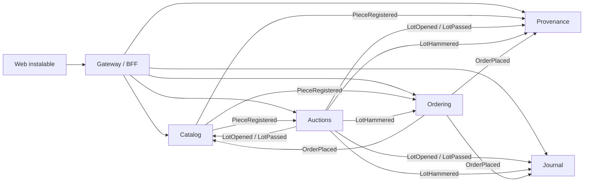

# Musa

Una casa digital para el arte, el diseño y la moda, construida como sistema de microservicios en .NET 10 con Aspire. Las obras se subastan en directo, las piezas se adquieren en la boutique, y todo lo que ocurre queda escrito: en un registro de procedencia encadenado y en un diario que la propia casa redacta.

Este es el **primer movimiento**: cinco servicios, un gateway y una web instalable, conversando solo por eventos.

## Ponerlo en marcha

Requisitos: SDK de .NET 10, Docker en marcha.

```bash
dotnet run --project src/Musa.AppHost     # levanta PostgreSQL, RabbitMQ, los servicios y el gateway
open http://localhost:5080                # la web
./scripts/opening-night.sh 90             # opcional: tres obras a subasta con paletas rivales pujando
dotnet test                               # reglas de la sala de subastas
```

El panel de Aspire (trazas, métricas y logs de todos los servicios) aparece en la salida del AppHost.

## Qué hay

| Contexto | Proyecto | Qué hace | Forma |
|---|---|---|---|
| Colección | `Catalog.API` | Piezas únicas de arte, moda y diseño. Dibuja el retrato generativo de cada pieza a partir de su id. | CRUD |
| Sala | `Auctions.API` · `.Domain` · `.Infrastructure` | Lotes, pujas, escalera de incrementos, reserva confidencial, cierre suave contra pujas de último segundo, martillo. Pujas en directo por server-sent events. | DDD |
| Pedidos | `Ordering.API` | Factura del remate con comisión del comprador por tramos; compra directa en boutique. Una pieza única solo puede venderse una vez. | CRUD |
| Procedencia | `Provenance.API` | Historia de cada pieza como libro encadenado por hash; cualquier alteración rompe la cadena. | Solo escucha |
| Diario | `Journal.API` | Ensayos, notas del día y la crónica que Musa escribe sola a partir de lo que pasa. | CRUD |
| Puerta | `Musa.Gateway` | Único punto público: sirve la web, enruta con YARP y limita el ritmo de pujas. | BFF |
| | `Musa.EventBus` | Bus sobre RabbitMQ con outbox y propagación de trazas. | Bloque común |

## Cómo conversan



Ningún servicio llama a otro. Cada uno tiene su base de datos, guarda una copia de los datos ajenos que necesita y se entera de los cambios por eventos. Cada evento se escribe en la misma transacción que el cambio que lo origina (outbox) y todos los consumidores toleran recibirlo dos veces.

Un remate, de principio a fin: la sala cierra el lote → `LotHammered` → Pedidos emite la factura con comisión → `OrderPlaced` → la Colección marca la pieza como vendida, la Procedencia añade dos líneas a su cadena y el Diario publica la crónica.

## Lo que este movimiento no tiene todavía

- **Identidad.** La "paleta" se elige en un desplegable; no hay autenticación. Es lo primero del segundo movimiento (OIDC, JWT validado en cada servicio).
- **Pagos.** El pedido se crea; nadie cobra.
- **Apps nativas.** La web es instalable como PWA en móvil y escritorio; no hay app .NET MAUI.
- **Migraciones.** Las tablas se crean al arrancar (`EnsureCreated`) y la base de datos se pierde al parar el AppHost.
- **Mensajes fallidos.** Tras tres intentos se descartan; falta cola de mensajes muertos.
- **Una sola réplica** de la sala: el canal en directo vive en memoria.

## Movimientos siguientes

II. Identidad y perfiles de coleccionista · pagos con saga y compensación · migraciones y volumen de datos.
III. Apps móvil y de escritorio (.NET MAUI) sobre un segundo BFF · salas de visionado privadas · notificaciones.
IV. Curaduría: búsqueda semántica y recomendaciones · exposiciones · despliegue en Kubernetes.

Todos los creadores, casas y obras son ficticios.
